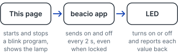
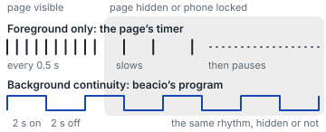

# Blink an LED

[Open the demo](https://wklm.github.io/beacio-sdk/) on an iPhone with [beacio](https://beacio.com),
the Safari extension that brings Web Bluetooth to iOS.

One page, two ways to blink a Bluetooth LED:

- **Foreground only.** The page sends each on and off itself. Safari slows it, then pauses it, when the page is hidden.
- **Background continuity.** The page hands beacio a tiny program, and beacio keeps blinking while the page is hidden or the phone is locked.

## Step by step

1. **Open the beacio app and leave it running.** You see the beacio app. Come back to Safari.
2. **Tap Connect and choose your LED** (or **EmulatedPeripheral**). You see the lamp on the page say Connected, On or Off.
3. **Pick who keeps it blinking:** Foreground only or Background continuity. You see your choice ticked.
4. **Tap Start blinking.** You see the LED and the lamp blink.
5. **Leave Safari or lock the phone.** Watch the LED. Foreground only: it slows, then stops. Background continuity:
   it keeps blinking every 2 s.
6. **Come back to the page.** You see the lamp catch up. Coming back does not stop a background program.
7. **Tap Stop.** You see the LED turn off if the page is connected. **Leaving the page does not stop a background
   program**: it keeps running, even for hours, until you tap Stop. If you leave one running, the page shows
   "A blink program from your last visit is still running" with a Stop button the next time you open it.
   That Stop ends the program, but the page is not connected yet, so it cannot send off. The page says
   "Stopped. The LED keeps its last state." Connect, then Start blinking and Stop, to turn the LED off.

The page highlights the step you are on.

## Who does what



In Foreground only, the page sends every blink itself, through beacio. In Background continuity,
it hands the beacio app one small program, and the app keeps it going.

## Why the page alone stops



A sketch, not a measurement: how soon Safari slows and pauses a hidden page varies.

## Good to know

- **2 s on, 2 s off.** 2000 ms is the time between commands and beacio's current minimum, not an iOS limit.
  A faster program is rejected, not slowed down.
- **Coming back doesn't stop it.** Only Stop does: it unregisters the program, then the page sends off if it is connected.
- **Best effort.** If iOS ends the beacio app or the Bluetooth link drops, blinks can be late or missed.
- **Twice is fine.** While beacio runs, a notified value can arrive twice. The lamp shows the value,
  not a count, so it stays right.

## LED example

All of it is in [`blink.js`](blink.js): about 70 lines, plain JavaScript, no page code.
[`app.js`](app.js) only draws the page: the lamp, the steps, the banner and the buttons. The core of `blink.js`:

```js
// 1. Connect, straight from the tap: Safari opens the chooser only from a user gesture.
const device = await new Beacio().requestDevice({ filters: [{ services: [SERVICE] }] });
await device.connect();
await device.subscribeAsync(SERVICE, LED, onValue, { autoRecover: false }); // the LED reports each value

// 2a. The page blinks it, one write every 500 ms. Safari slows this timer, then pauses it, when the page is hidden.
await device.write(SERVICE, LED, Uint8Array.of(ON));

// 2b. Or beacio blinks it, 2 s on and 2 s off, with the page hidden or the phone locked.
const service = await device.raw.gatt.getPrimaryService(SERVICE);
const led = await service.getCharacteristic(LED); // the program needs beacio's id for it, not the UUID
await navigator.beacio.backgroundSync.requestBackgroundConnection({
  deviceId: device.id,
  program: { deviceId: device.id, characteristicId: led.id, activeWhen: 'always',
    cycle: { frames: [[ON], [OFF]], timer: { cadence: 'uniform', everyMs: 2000 } } },
});

// 3. Stop. Leaving the page never stops a program. Unregister first, then off.
for (const program of await backgroundPrograms()) await program.unregister();
await device.write(SERVICE, LED, Uint8Array.of(OFF));
```

`blink.js` wraps these in a few functions: `connect()`, `blinkFromPage()`, `blinkInBackground()`,
`backgroundPrograms()`, `stopBackground()`, `switchOff()` and `canBlinkInBackground()`.
`blinkFromPage()` gives a stop function that waits for the write in flight, so a late on never lands after off.
There is no build step: [`index.html`](index.html) loads [`@beacio/core`](https://www.npmjs.com/package/@beacio/core) 2.2.0
from jsDelivr, pinned with a subresource integrity hash, then `app.js`, which imports `blink.js`.

The SDK turns each GATT step into one line with string UUIDs, and its errors carry a
`suggestion` you can show as is. Background programs are newer than @beacio/core 2.2.0, so
`blink.js` calls them on `navigator.beacio.backgroundSync` (or `navigator.bluetooth.backgroundSync`).
The page offers background continuity only when beacio supports programs, and it opens the
device chooser straight from your tap, as Safari requires.

To host the page yourself, serve this folder over HTTPS with a certificate the iPhone trusts.
On a computer, `python3 -m http.server` and `http://localhost:8000` in desktop Chrome
runs foreground mode, since Chrome has Web Bluetooth built in.

## No LED? Run the emulator

On a Mac or Linux computer near the phone:

```sh
cd examples/led-continuity/emulator
npm ci
npm start
```

- **macOS:** allow Bluetooth for your terminal app in System Settings > Privacy & Security > Bluetooth.
- **Linux:** stop `bluetoothd` (`sudo systemctl stop bluetooth`), then run with `sudo` or grant Node
  raw-socket access once: `sudo setcap cap_net_raw+eip "$(readlink -f "$(command -v node)")"`.

It advertises service `0000FFF0-0000-1000-8000-00805F9B34FB` with one characteristic,
`0000FFF1-0000-1000-8000-00805F9B34FB` (read, write with response, notify). It starts at `BE AC`,
so the page shows Connected until the LED reports on or off. Write `01` for on and `00` for off;
every write is notified back. Built on [`@stoprocent/bleno`](https://github.com/stoprocent/bleno)
(MIT). Its install scripts are denied in `package.json`: the packages ship prebuilt binaries.

## Test

```sh
cd examples/led-continuity/test
npm ci
npx playwright install chromium
npx playwright test
```

One smoke test runs the page and the published SDK file against a Bluetooth double, and checks
that the steps, the pictures and the leftover-program banner render, that the SVG files here
match the ones on the page, and that Pages publishes every file the page loads. It does not prove radio behaviour or iOS background timing.
